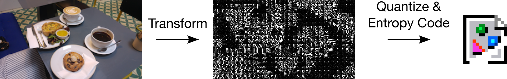
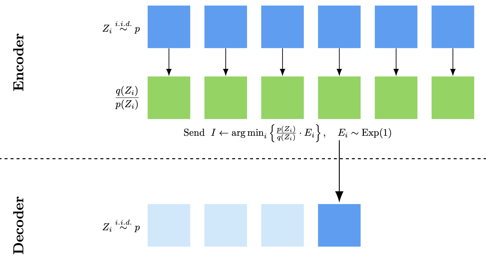
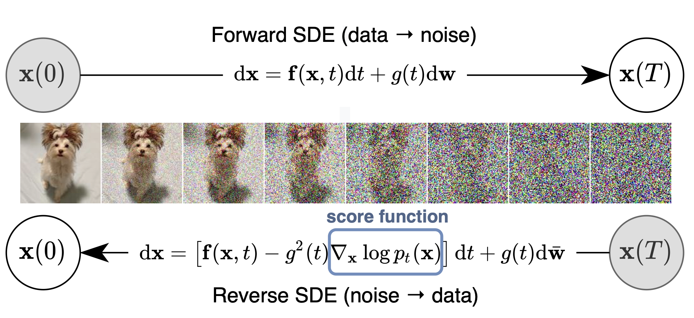
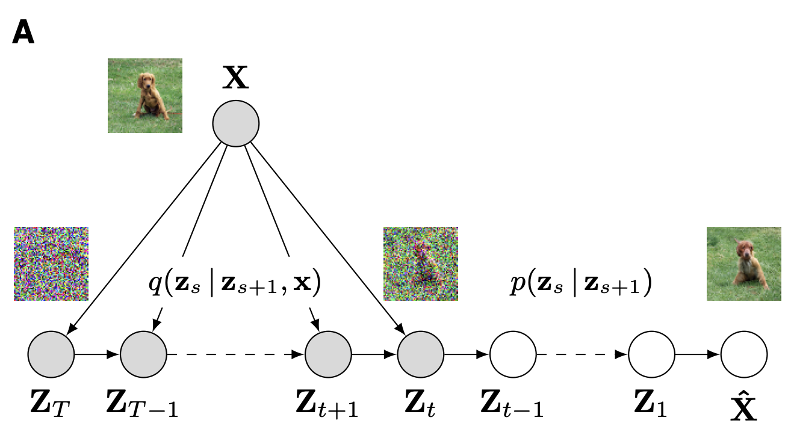

#+TITLE: Data Compression with Diffusion Models
#+author: Gergely Flamich
#+date: 10/08/2026

#+REVEAL_ROOT: https://cdn.jsdelivr.net/npm/reveal.js
# This is needed to make the speaker notes work
#+REVEAL_REVEAL_JS_VERSION: 4
#+OPTIONS: reveal_title_slide:"<h2>%t</h2><h2>%s</h2> <h4>%a</h4><h4>%d</h4>"
#+OPTIONS: toc:nil
#+OPTIONS: num:nil
#+REVEAL_THEME: white
#+REVEAL_INIT_OPTIONS: slideNumber:'c/t', transition:'none'
#+REVEAL_HLEVEL:0
#+REVEAL_MATHJAX_URL: https://cdn.jsdelivr.net/npm/mathjax@3/es5/tex-mml-chtml.js
#+REVEAL_EXTRA_CSS: ./presentation_styles.css

* In Collaboration With

#+REVEAL_HTML: 
#+REVEAL_HTML: 
#+REVEAL_HTML: 

* lossy data compression
#+ATTR_REVEAL: :frag (appear)
Have some data $X$

#+ATTR_REVEAL: :frag (appear)
*Encode:*
#+ATTR_REVEAL: :frag (appear)
- Transform $f(X)$
- **Quantise**: $Z \gets \lfloor f(X) \rceil$
- Lossless code: $S \gets C(Z)$

#+ATTR_REVEAL: :frag (appear)
*Decode:*
#+ATTR_REVEAL: :frag (appear)
- Recover: $Z \gets C^{-1}(S)$
- Reconstruct: $\hat{X} = g(Z)$

* example: jpeg

#+ATTR_REVEAL: :frag (appear)

#+ATTR_REVEAL: :frag (appear)

# * example: jpeg
# #+ATTR_REVEAL: :frag (appear)
# - $f(x) = \mathrm{DCT}(x) / M$
# - $g(y) = \mathrm{IDCT}(M \odot y)$
# - could we learn $M$?
# - $\hat{x} = g(\lfloor f(x) \rceil)$
# - quantisation not differentiable!
# - idea: swap quantisation for adding Gaussian noise!
# - $\hat{x} = g(f(x) + \epsilon)$

* performance measures
#+ATTR_REVEAL: :frag (appear)
- *Rate:* number of bits $\mathbb{E}[|C(Z)|]$
- *Distortion:* $\mathbb{E}[\Delta(X, \hat{X})]$
  - MSE / PSNR
  - LPIPS
  - DISTS

* learned compression
#+ATTR_REVEAL: :frag (appear)
- Transform: $\hat{x} = g(\lfloor f(x) \rceil)$
- Entropy model: $p(z)$
- Loss: $\mathcal{L}(\beta) = \mathbb{H}[Z] + \beta \cdot \mathbb{E}[\Delta(X, \hat{X})]$

#+ATTR_REVEAL: :frag (appear)
❌ Quantisation not differentiable!

#+ATTR_REVEAL: :frag (appear)
💡Add noise instead:
$\hat{x} = g(f(x) + \epsilon)$

#+ATTR_REVEAL: :frag (appear)
🤔 How to encode $f(x) + \epsilon$?

* relative entropy coding
#+ATTR_REVEAL: :frag (appear)
*Goal:* given $q$, encode a sample $Z \sim q$

#+ATTR_REVEAL: :frag (appear)
💡Use a proposal $p$; sample with *shared seed*

#+ATTR_REVEAL: :frag (appear)
*Minimal random coding:*

#+ATTR_REVEAL: :frag (appear)
- Draw $Z_1, \dotsc, Z_N \sim p$
- Select $Z_i$ with probability $\propto \frac{q(Z_i)}{p(Z_i)}$
- Encode selected index $I$.

* minimal random coding

* a* coding
#+ATTR_REVEAL: :frag (appear)
$E_1, \dotsc, E_N \sim \mathrm{Exp}(1)$

#+ATTR_REVEAL: :frag (appear)
$$
I_{MRC} = \mathrm{argmin}_{i \in [1:N]} \left\{\frac{p(Z_i)}{q(Z_i)} \cdot E_i \right\}
$$
#+ATTR_REVEAL: :frag (appear)
$$
I_{A^*} = \mathrm{argmin}_{i \in [1:N]} \left\{\frac{p(Z_i)}{q(Z_i)} \cdot \sum_{j = 1}^{i} E_j \right\}
$$
#+ATTR_REVEAL: :frag (appear)
$\mathbb{H}[I_{A^*}] \leq  \mathrm{KL}[q || p] + O(\log_2 \mathrm{KL}[q || p])$

# - draw $N$ samples $Z_1, Z_2, \dotsc, Z_N \sim p$
# - compute importance weights: $r(Z_i) = q(Z_i)/p(Z_i)$
# - select index $K$ with $\mathbb{P}[K = k] \propto r(Z_k)$
# - encode $K$ using $\log_2 N$ bits
# - how big should $N$ be?
# - pick 

* Putting things together
#+ATTR_REVEAL: :frag (appear)
*Training*
#+ATTR_REVEAL: :frag (appear)
- Model: $Z = f(x) + \epsilon, \quad \hat{X} = g(Z)$
- Loss: $\mathrm{KL}[q(Z \mid X) || p(Z)] + \beta \cdot \mathbb{E}[\Delta(X, \hat{X})]$

#+ATTR_REVEAL: :frag (appear)
*Compression*
#+ATTR_REVEAL: :frag (appear)
- A* coding: encode $Z \sim q(z \mid x)$
- Budget: ${\color{red} N \approx 2^{\mathrm{KL}[q(Z \mid x) || p(Z)]}}$

* diffusion models
#+ATTR_REVEAL: :frag (appear)

# - Forward process: $Z_t = \alpha_t X + \beta_t \epsilon_t$
# - Backward denoiser: $g_t(z) = \mathbb{E}[X \mid Z_t = z]$
# - Backward distribution: $p(z_s \mid z_t) \approx \mathcal{N}(\mathbb{E}[Z_s \mid Z_t = z_t], \sigma_t^2 I)$

#+REVEAL_HTML: <small class="fragment (appear)">Song, Yang, et al. "Score-based generative modeling through stochastic differential equations."</small>

* the key identity
#+ATTR_REVEAL: :frag (appear)
When denoiser is perfect:
#+ATTR_REVEAL: :frag (appear)
$$
\mathrm{KL}[q(Z_s \mid X) || p(Z_s) ] = \mathrm{KL}[q(Z_{s:t} \mid X) || p(Z_{s:t})]
$$
#+ATTR_REVEAL: :frag (appear)
For compression:
#+ATTR_REVEAL: :frag (appear)
\begin{align*}
&\mathrm{KL}[q(Z_{s:t} \mid X) || p(Z_{s:t})] \\
\quad\quad &= \sum_{k = t}^s \mathrm{KL}[q(Z_{k} \mid X, Z_{k - 1:t}) || p(Z_k \mid Z_{k - 1:t})]
\end{align*}

* diffC
#+ATTR_REVEAL: :frag (appear)

#+REVEAL_HTML: <small class="fragment (appear)">Theis, Lucas, et al. "Lossy compression with Gaussian diffusion."</small>

* diffc for video compression
# #+REVEAL_HTML: <video data-autoplay loop muted src="./img/vids/v4p_ours30_0p0080.mp4" width=49%></video>
# #+REVEAL_HTML: <video data-autoplay loop muted src="./img/vids/v4p_hevc_0p0108.mp4" width=49%></video>
#+REVEAL_HTML: <video data-autoplay loop muted src="./img/vids/v4_ours_b0p008.mp4" width=30%></video>
#+REVEAL_HTML: <video data-autoplay loop muted src="./img/vids/v4_hevc_848p_crf40.mp4" width=30%></video>

* towards practicality

#+ATTR_REVEAL: :frag (appear)
*Goal:* turn off-the-shelf model into video compressor

#+ATTR_REVEAL: :frag (appear)
*Angles of attack:*
#+ATTR_REVEAL: :frag (appear)
1. Streamline and scale existing techniques
2. Diffusion-specific improvements

* the model
#+REVEAL_HTML: </img>

#+ATTR_REVEAL: :frag (appear)
- Wan 2.1: rectified flow model
- No reflow: can derive equivalent to DDPM!

* possible choices for probabilistic model
#+REVEAL_HTML: </img>

* empirical findings
#+REVEAL_HTML: </img>

* the challenge to tackle
#+REVEAL_HTML: </img>

* single step techniques
#+ATTR_REVEAL: :frag (appear)
- $\mathrm{KL}[q(Z_s \mid Z_t, x) || p(Z_s \mid Z_t)]$ too high
- Shuffle dimensions
- Partition into $D$ fixed-size chunks
- Per-chunk $\mathrm{KL}$ budget: 16 bits
- REC each chunk in parallalel

* streamlined implementation
#+REVEAL_HTML: <figure class="fragment (appear)"></img>
#+REVEAL_HTML: <figcaption><small>Table: sec/81-frame block. Bitrate within 0.15%, LPIPS within 0.0008</small></figcaption></figure>

* across diffusion steps
#+ATTR_REVEAL: :frag (appear)
- Reduce number of diffusion steps
- $\mathrm{KL} = \frac{1}{2}\Delta \mathrm{SNR}_t \cdot \Vert x_0 - \hat{x}_0(x_t) \Vert^2$
- Quadratic grid based on $\Delta \mathrm{SNR}_t$
- Widen final proposal variance
- Cut later steps, use DDIM

* state-of-the-art video compression with REC
#+REVEAL_HTML: 

* effect of widening
#+REVEAL_HTML: 

* compression speed
#+REVEAL_HTML: 

* rate vs compression speed
#+REVEAL_HTML: 

* take-home messages
#+ATTR_REVEAL: :frag (appear)
- Relative entropy coding: lossy compression using any probabilistic model
- DiffC: combine REC with diffusion models
- Implemented almost real-time video compression with REC
- Lots of potential: realism, differential privacy

* another video comparison
#+REVEAL_HTML: <video data-autoplay loop muted src="./img/vids/v4p_ours30_0p0080.mp4" width=50%></video>
#+REVEAL_HTML: <video data-autoplay loop muted src="./img/vids/v4p_hevc_0p0108.mp4" width=50%></video>

* bd-rates
#+REVEAL_HTML: 

* different grids
#+REVEAL_HTML: 
* different grid results
#+REVEAL_HTML: 

* effect of grid resolution
#+REVEAL_HTML: 

